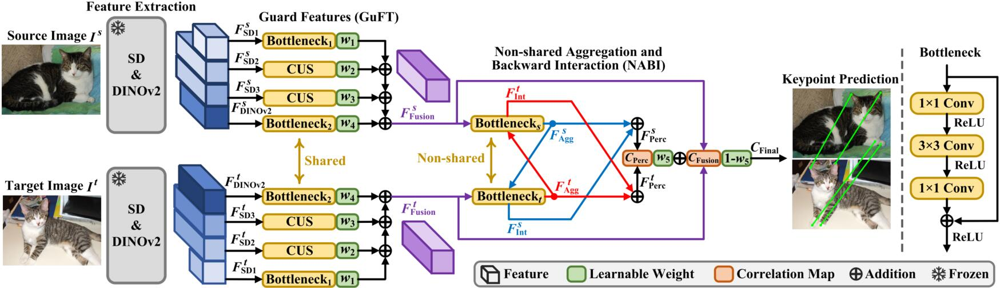
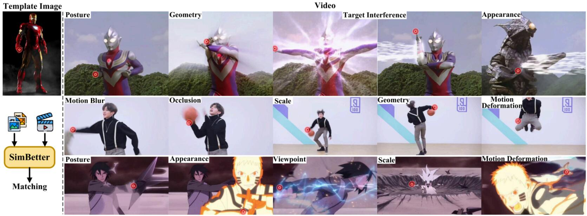

# SimBetter
## Simpler is Better: Feature Guard and Interaction for Semantic Correspondence
This paper was accepted for publication in  IEEE Transactions on Image Processing  ([https://ieeexplore.ieee.org/document/11526938](https://ieeexplore.ieee.org/document/11526938)).

## Abstract
Semantic correspondence establishes keypoint correspondences between different instances of the same category. Fusing texture and semantic features from vision foundation models like stable diffusion (SD) and DINO significantly improves matching performance. However, we found an unnoticed yet essential problem: current feature fusion enhances the edge and semantic information in SD features with fine textures and DINOv2 features with fine semantics, but it destroys the semantic and structural information in SD features with weak and coarse semantics. We propose guard features (GuFT), a simple yet efficient method, to prevent feature degradation. Moreover, matching methods designed for traditional deep neural networks can be simplified based on two key insights: 1) vision foundation models provide rich visual knowledge; and 2) GuFT yields high-quality feature descriptors. We propose a bottleneck-style non-shared aggregation and backward interaction (NABI) module to efficiently capture intra- and inter-feature relationships, instead of common self- and cross-attention. The resulting framework, SimBetter, embodies a "simpler is better" design philosophy. 


<div align='center'>

</div>


## Application of Image-Video Semantic Correspondence

<div align='center'>

</div>


## Environment Setup

```bash
conda create -n simbetter python=3.9
conda activate simbetter
conda install pytorch==2.1.1 torchvision==0.16.1 torchaudio==2.1.1 pytorch-cuda=11.8 -c pytorch -c nvidia
conda install -c "nvidia/label/cuda-11.8.0" libcusolver-dev
git clone git@github.com:wzhlearning/SimBetter.git 
cd SimBetter
pip install -e .
```

You should install [xformers](https://github.com/facebookresearch/xformers) for efficient transformer (which can significantly reduce the VRAM consumpution):
```
pip install xformers==0.0.23
```

You should install [SAM](https://github.com/facebookresearch/segment-anything) to extract the instance masks for adaptive pose alignment:

```
pip install git+https://github.com/facebookresearch/segment-anything.git
wget https://dl.fbaipublicfiles.com/segment_anything/sam_vit_h_4b8939.pth
```

## Start
### 1.  Prepare  datasets
We provide the scripts to download the datasets in the `data` folder. To download specific datasets, use the following commands:

* SPair-71k: 
```bash
bash data/prepare_spair.sh
```
* PF-Pascal: 
```bash
bash data/prepare_pfpascal.sh
```
* AP-10k:

First, download the [original dataset](https://github.com/AlexTheBad/AP-10K) with the following command:
```bash
bash data/prepare_ap10k.sh
```
Then, you could preprocess AP-10k to get the correspondence benchmark by running the notebook [prepare_ap10k.ipynb](prepare_ap10k.ipynb).

### 2. Pre-extract features

To enable efficient training and evaluation, we pre-extract the feature maps of the datasets. To do so, run the following commands:

* SPair-71k: 
```bash
python preprocess_map.py ./data/SPair-71k/JPEGImages
```

Substitute the path `./data/SPair-71k/JPEGImages` with `./data/PF-Pascal/JPEGImages` or `./data/AP-10k/JPEGImages` for PF-Pascal and AP-10k, respectively.

### 3. Training
### Training on AP-10k

```bash
python pck_train.py --config configs/train_ap10k.yaml
```
Some important parameters in [train_ap10k.yaml](./configs/train_ap10k.yaml) include:
* `--AP10K_EVAL_SUBSET` to evaluate on the different test settings (e.g., cross-species, cross-family).
* `--COMPUTE_GEOAWARE_METRICS`: set to True to evaluate on the geometry-aware semantic correspondence subset.
* `--PAIR_AUGMENT`: set to True to enable the pose-variant pair augmentation.
* `--LOAD`: the path to the pretrained weight. Noth that train_ap10k.yaml does not require this option.

### Pre-Training on AP-10k
AP-10k pre-training is actually performed on the test set. The parameter setting on line 327 of pck_train.py needs to be manually modified: change "**split**" from "**val**" to "**test**". Except for the AP-10 pretraining, all other experiments must be set to "**val**". See [issue of GeoAware-SC](https://github.com/Junyi42/GeoAware-SC/issues/8)
```bash
def eval(args, aggre_net, save_path, split='val'): #  pretrain ap10k: split='test'; other: split='val'

python pck_train.py --config configs/train_ap10k.yaml
```

### Training on SPair-71k (with pretrained weight)

```bash
python pck_train.py --config configs/train_spair.yaml
```

Note that the `TEST_SAMPLE` is the number of sampled pairs for each category for evaluation, which is set to 20 by default. Set to `0` to use all the samples in the evaluation set.

### Training on PF-Pascal (with pretrained weight)

```bash
python pck_train.py --config configs/train_pascal.yaml
```

### 4. Evaluation

```bash
python pck_train.py --config configs/eval_spair.yaml
```

You could also replace the `--config` with `configs/eval_pascal.yaml` or `configs/eval_ap10k.yaml` to evaluate on PF-Pascal or AP-10k.


## Citation
```BiBTeX
@ARTICLE{Wang2026Simpler,
  author  = {Wang, Zenghui and Du, Songlin and Xiao, Guobao},
  journal = {IEEE Transactions on Image Processing}, 
  title   = {Simpler is Better: Feature Guard and Interaction for Semantic Correspondence}, 
  year    = {2026},
  volume  = {35},
  number  = {},
  pages   = {5626-5640},
  doi     = {10.1109/TIP.2026.3693144}
}

```


## Acknowledgement
Our code is largely based on the following open-source projects: [A Tale of Two Features](https://github.com/Junyi42/sd-dino), [GeoAware-SC](https://github.com/Junyi42/GeoAware-SC), and [Tex2Sem](https://github.com/wzhlearning/Tex2Sem). We are deeply grateful for their spirit of open-source sharing.